# 04 · Diagramas técnicos (Mermaid)

> Fecha: 2026-10-18. Representan la **arquitectura propuesta** (`03`), no software existente. Se renderizan en GitHub y en la mayoría de visores Markdown con Mermaid.

## 1. Arquitectura general

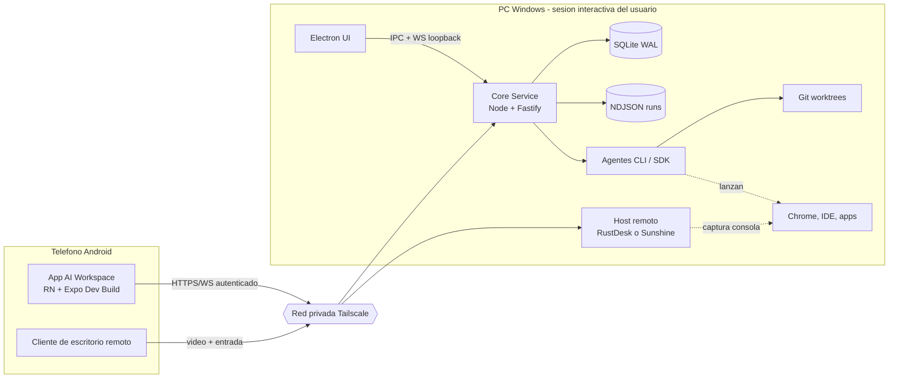

## 2. Arquitectura de componentes

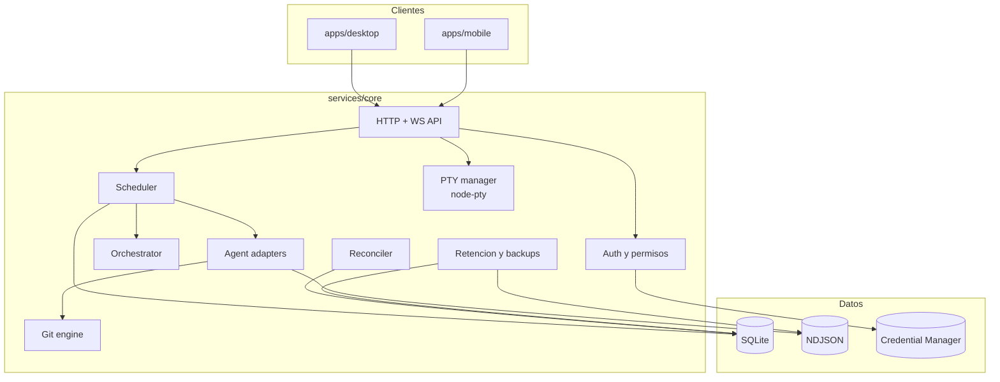

## 3. Despliegue Windows - Android

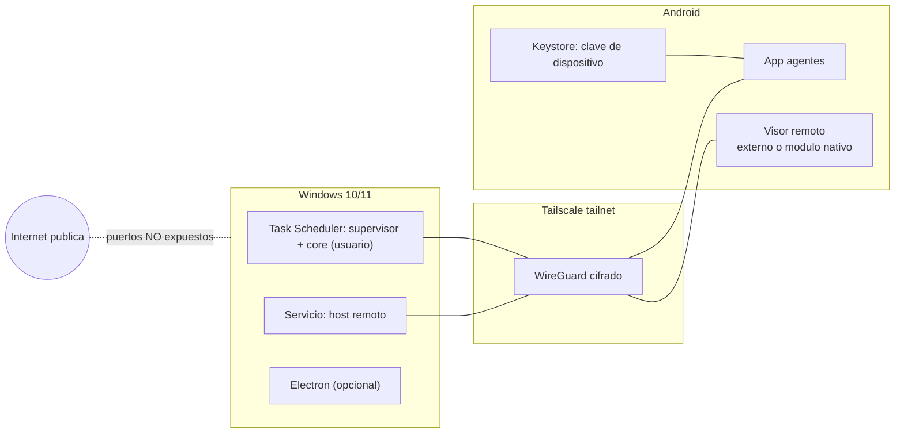

## 4. Casos de uso

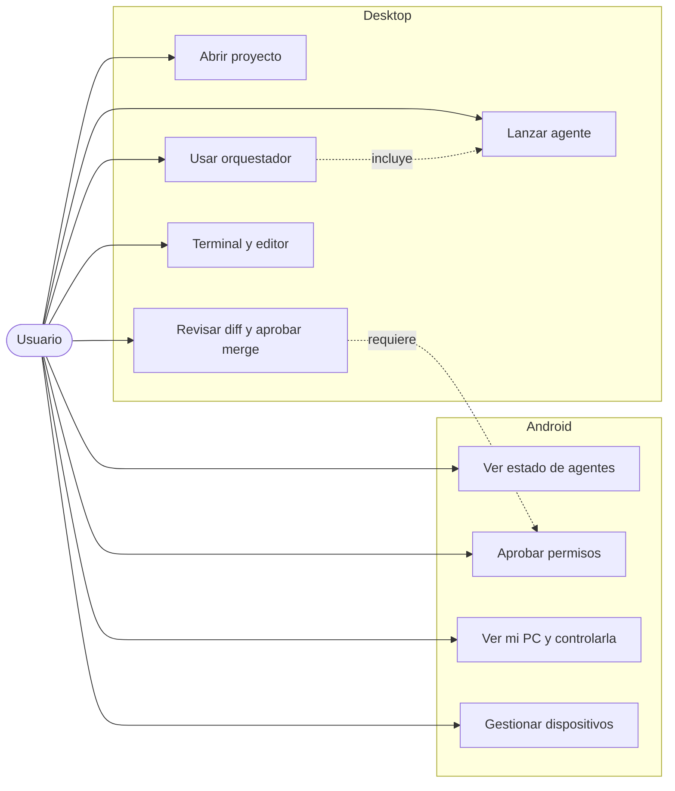

## 5. Entidades y relaciones

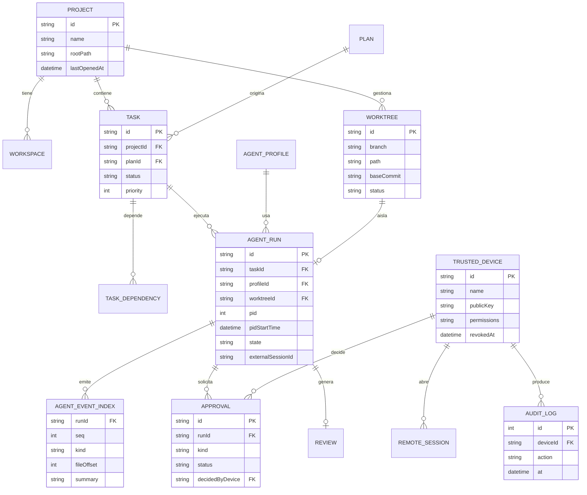

## 6. Secuencia: ejecutar un agente

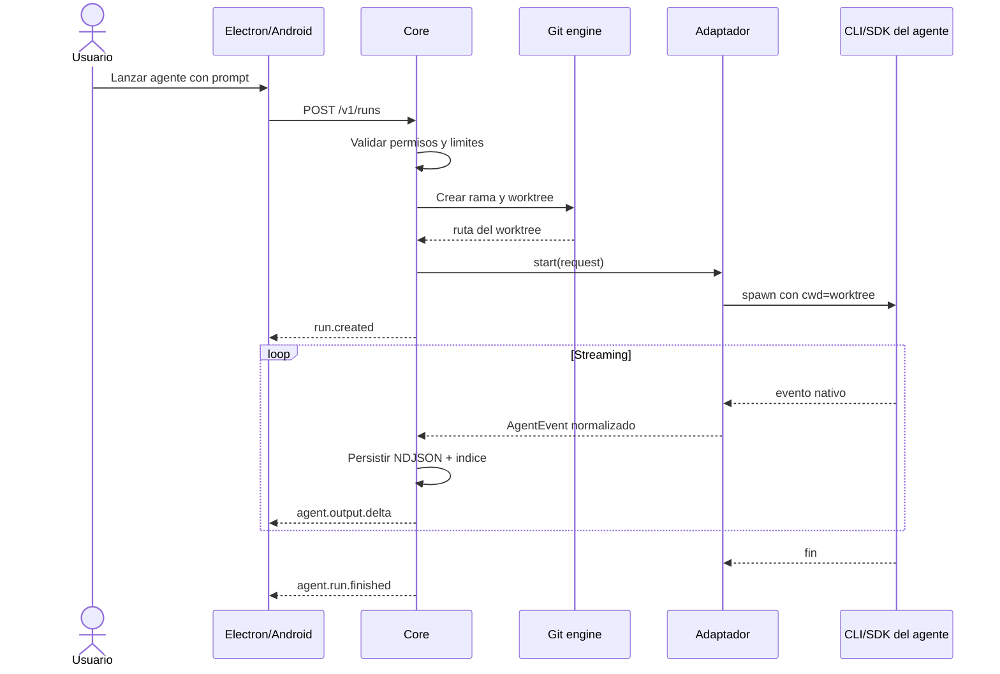

## 7. Secuencia multiagente

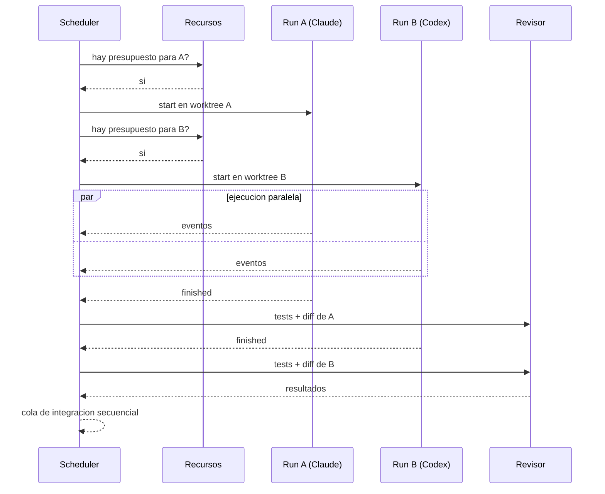

## 8. Flujo de orquestación

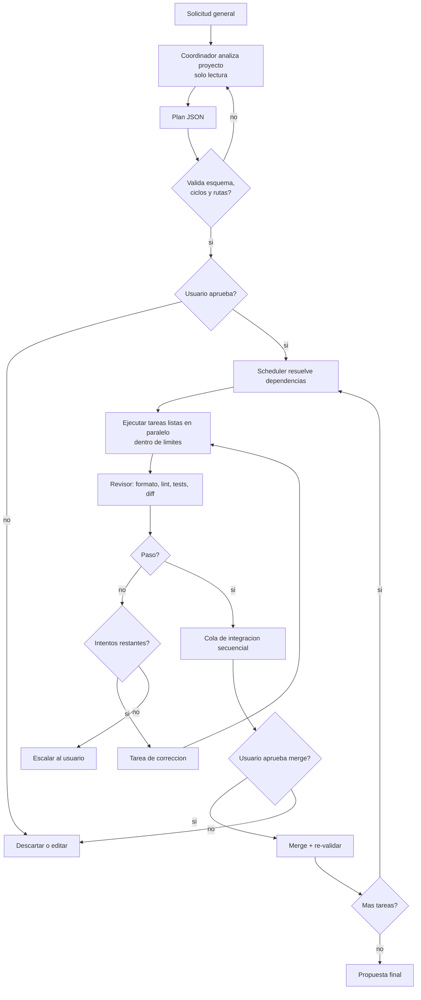

## 9. Flujo de Git worktrees

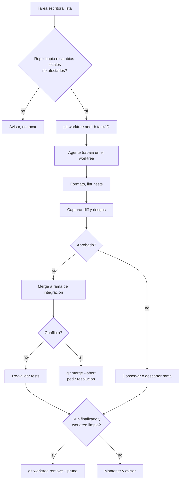

## 10. Flujo de acceso remoto

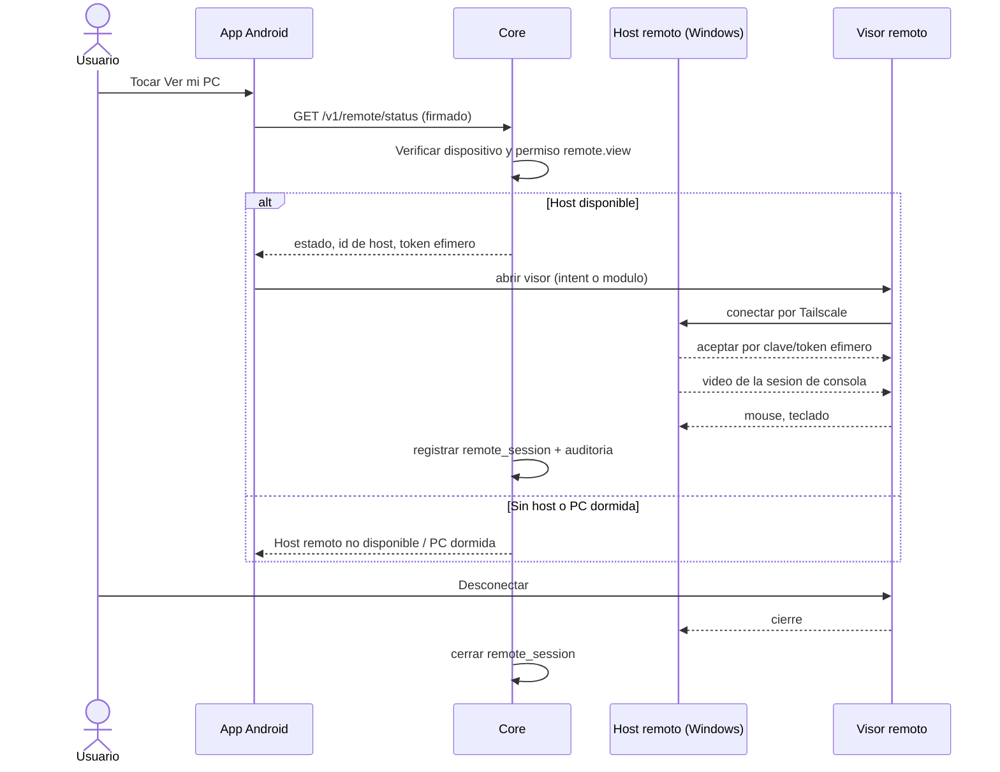

## 11. Estados de un run de agente

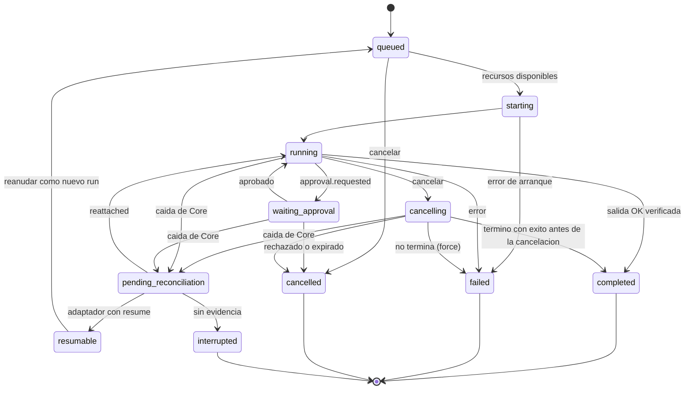

## 12. Autenticación y autorización

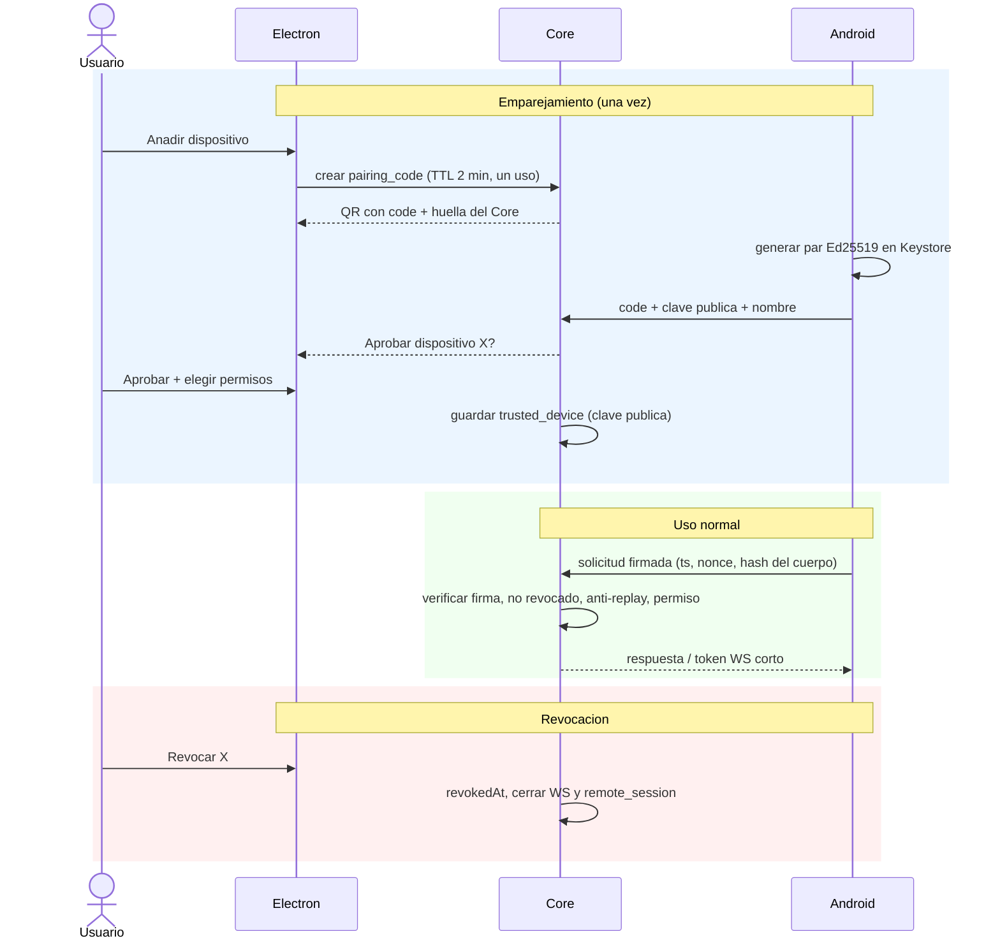

## 13. Recuperación ante errores

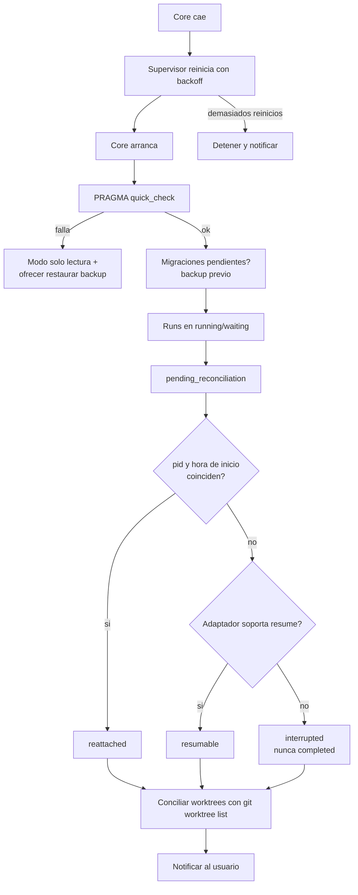

## 14. Respaldos

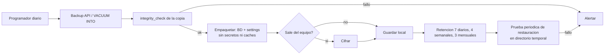

## 15. Dependencias de módulos

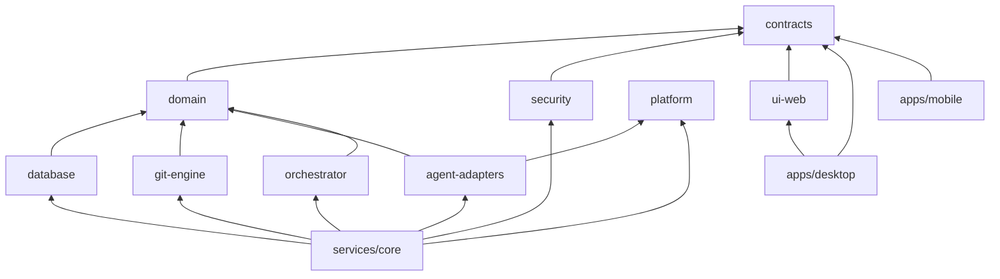

> **Reglas prohibidas (a verificar en CI):** `apps/*` → `services/*`; `agent-adapters` → `database`; cualquier paquete → `apps/*`; ciclos.
